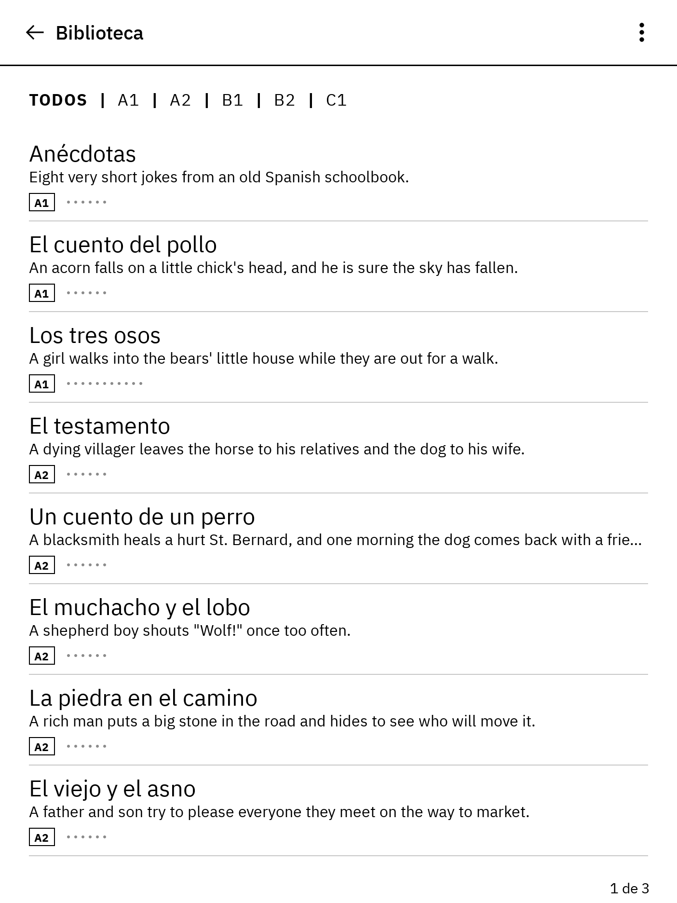
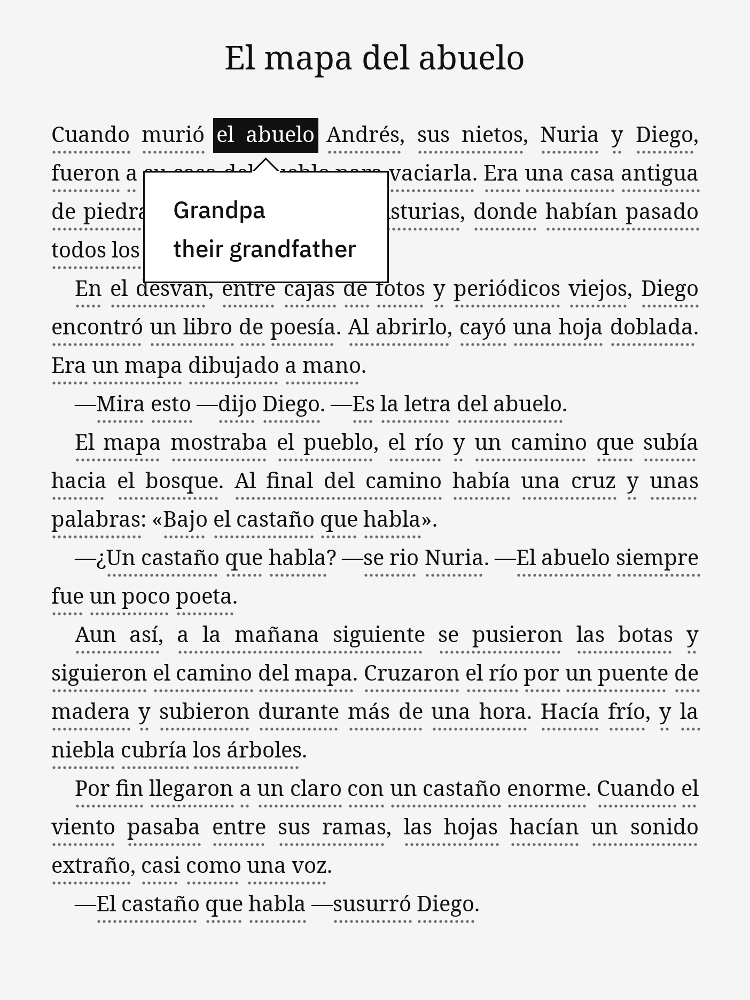
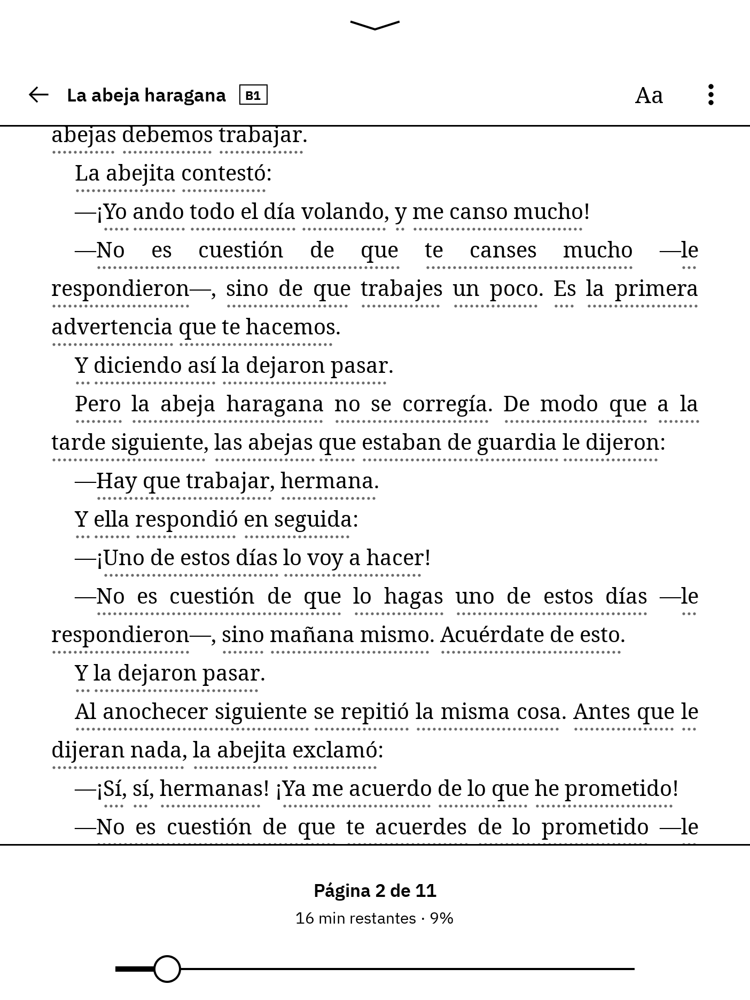
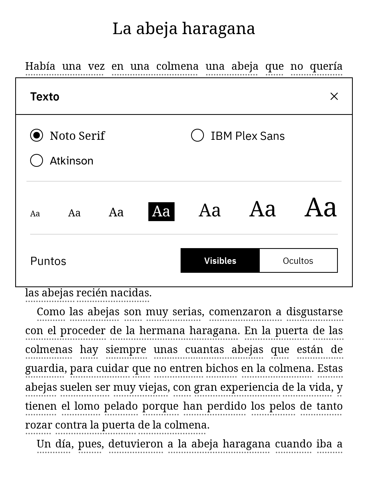

# Spanish Reader for reMarkable

A graded Spanish story reader for the reMarkable tablet. Pick a story, read it
on the e-ink screen, and tap any dotted word or phrase to see what it means
(like Duolingo's stories). Every translation comes from the story file, so
there is no dictionary and nothing to download on the tablet.

| Library | Reading | Toolbar | Text |
|---|---|---|---|
|  |  |  |  |

More screens are in [`docs/screens/`](docs/screens).

**Features**

* 9 original stories from A1 to B1, with translations that fit the context
  (*tiene ocho años* → "is eight years old", not "has eight years").
* Words and whole phrases are underlined with dots. Tap one and it turns
  black, and a box shows the English (all the alternatives, one per line).
  Tap anywhere else to close it.
* Justified, paginated text in Noto Serif. Tap the left or right margin, or
  swipe, to turn the page. Your position in each story is saved.
* Tap the top of the page for the toolbar: back, the story's title and level,
  **Aa** (font: Noto Serif, IBM Plex Sans or Atkinson Hyperlegible; 7 text
  sizes; dots on or off), **⋮** (go to the start, mark as read, reset
  progress), and a page slider with the time left.
* Tap the bottom of the page to show or hide the page number.
* The library lists the stories you read last first, filters by level
  (TODOS / A1 / A2 / B1 / B2 / C1), and shows each story's progress.

## Requirements

* reMarkable 2. The reMarkable Paper Pro / Move build is included but untested.
* [xovi](https://github.com/asivery/xovi) with
  [AppLoad](https://github.com/asivery/rm-appload) and qt-resource-rebuilder.
  These need firmware **3.22 or newer**. Follow the step-by-step guide:
  <https://xovi.bearblog.dev/appload/>.

## Install (all on the tablet)

Everything lives in one folder on the tablet, `/home/root/spanish-stories`,
which holds `install.sh`, `uninstall.sh`, the app and the stories.

1. Copy `dist/spanish-stories.zip` (or `dist/spanish-stories.tar.gz`) to the
   tablet. Over USB the tablet is at `10.11.99.1`. The root password is under
   **Settings → Help → Copyrights and licenses**.

   ```bash
   scp dist/spanish-stories.zip root@10.11.99.1:
   ```

2. On the tablet (`ssh root@10.11.99.1`), unpack the archive in `/home/root`
   and run the installer:

   ```bash
   cd /home/root
   unzip -o spanish-stories.zip
   /home/root/spanish-stories/install.sh
   ```

   `tar -xzf spanish-stories.tar.gz` works too. The installer checks that
   AppLoad is there (if it is missing, it prints where to get it) and installs
   the build that matches the tablet's CPU.

3. Open the **AppLoad** menu, tap **Reload**, and tap **Spanish Reader**. The
   **←** in the library closes the app.

To update, unpack a newer archive over the same folder and run `install.sh`
again. Your reading progress and your own stories are kept.

## Uninstall

On the tablet:

```bash
/home/root/spanish-stories/uninstall.sh            # keeps your reading progress
/home/root/spanish-stories/uninstall.sh --purge    # also deletes it
rm -r /home/root/spanish-stories                   # deletes the stories and scripts too
```

## Adding your own stories

A story is a JSON file holding a list of `(spanish, english)` pairs:

```json
{
  "title": "El gato de Luna",
  "title_en": "Luna's Cat",
  "level": "A1",
  "description": "One morning Luna's black cat, Sol, has disappeared.",
  "content": [
    ["Luna", "Luna"],
    ["tiene", "is"],
    ["ocho años", "eight years old"],
    [".", ""],
    ["\n", ""],
    ["¿", ""],
    ["Dónde", "Where"],
    ["está", "is / is located"],
    ["?", ""]
  ]
}
```

* Each pair is one tappable unit, either a single word or a phrase.
* Put alternative translations in one string separated by `" / "`, or use a
  list: `["que", ["that", "who"]]`.
* Punctuation goes in its own pair with an empty translation. Spacing is
  automatic (no space before `.,;:!?»`, none after `¿¡«`).
* `["\n", ""]` starts a new paragraph.
* All fields except `content` are optional. A bare list of pairs also works,
  and the title then comes from the file name. A `level` outside A1–C1 gets
  its own tab.

Writing JSON by hand is tedious, so there is a shorter text format:

```text
title: El gato de Luna
title_en: Luna's Cat
level: A1

[Luna|Luna] [tiene|is] [ocho años|eight years old]. [Tiene|She has] [un gato|a cat] [que|that / who] [se llama|is called] [Sol|Sol].

—¿[Dónde|Where] [está|is] [Sol|Sol]? —[grita|shouts] [Luna|Luna].
```

```bash
python tools/story_from_text.py my-story.txt     # writes my-story.json
python tools/validate_stories.py my-story.json   # checks it
```

The sources of the included stories are in [`stories/src/`](stories/src).

**Put a story on the tablet** by copying it into the stories folder:

```bash
scp my-story.json root@10.11.99.1:/home/root/spanish-stories/stories/
```

Then tap **⋮ → Recargar cuentos** in the library (or reopen the app). If a
file can't be read, the same menu shows **Archivos con errores**, which says
which file and why.

## Building

The ready-to-copy archives are already in `dist/`. To rebuild them after
changing the code or stories, you need Go 1.21+ and Python with PySide6
(which provides Qt's `rcc`):

```bash
pip install PySide6
python tools/story_from_text.py --all   # stories/src/*.txt -> stories/*.json
python tools/build.py                   # -> dist/spanish-stories/, .zip, .tar.gz
```

## Trying it on a computer (emulator)

`emulator/` runs the real app on your computer as a 1404×1872 reMarkable 2
screen. It uses the same compiled QML, the same Go backend and the same
message protocol, with a stand-in for AppLoad. The mouse acts as your finger.

```bash
emulator/run_emulator.sh            # macOS / Linux
emulator\run_emulator.ps1           # Windows
```

Options: `--fresh` forgets saved progress, and `--verbose` logs every message.
Press **S** for a screenshot or **Esc** to quit.

Tests:

| Command | What it checks |
|---|---|
| `cd backend && go test ./...` | story parsing, progress, library order, the message protocol |
| `emulator/run_emulator.sh --test` | drives the UI with taps and swipes: library tabs and pages, translations, page turns, page number, toolbar and slider, text settings, the story menu, closing the app, and the layout of every story in every font at the smallest and largest text size; saves screenshots to `build/emulator/test-shots/` |
| `emulator/device_test.sh` (Linux/WSL with `qemu-user`, after `tools/build.py`) | unpacks the zip and tar.gz into a fake `/home/root`, runs the on-tablet `install.sh` / `uninstall.sh`, then runs the installed **ARM** backend under qemu with a fake AppLoad over a real unix `SEQPACKET` socket, for both rM2 (armv7) and Paper Pro (aarch64). Set `BUSYBOX=/path/to/busybox` to use busybox's `unzip` and `sh`, like the tablet. |

## How it works

```
package/               install.sh, uninstall.sh, README.txt for the tablet
app/
  manifest.json        AppLoad app description (id, entry point, uses a backend)
  application.qrc      -> resources.rcc: the QML user interface + fonts + images
  ui/main.qml          root item; talks to the backend through AppLoad
  ui/LibraryView.qml   story list with level tabs
  ui/ReaderView.qml    paginated text, dotted words, popover, toolbar
  ui/components/       popover, toolbars, menus, the Texto box
  ui/js/layout.js      justified line breaking and pagination
backend/               Go program started by AppLoad: reads stories, saves progress
stories/               the bundled stories (+ src/ in the short text format)
tools/                 build, story converter, validator, icon generator
emulator/              desktop emulator and tests
```

`install.sh` copies `app/` to `/home/root/xovi/exthome/appload/spanish-reader/`,
keeping the backend binary for the tablet's CPU, and links that folder's
`stories` to `/home/root/spanish-stories/stories`. AppLoad loads
`resources.rcc` into the tablet's own UI (xochitl) and starts `backend/entry`.
The two exchange JSON messages over a unix socket:

| Type | Direction | Meaning |
|---|---|---|
| 1 / 101 | UI → backend / reply | get the library (stories and progress, last read first) |
| 2 / 102 | | open a story (full text and saved position) |
| 3 | | save the reading position, or mark the story read |
| 5 / 105 | | save the text settings |
| 6 / 101 | | reset a story's progress |

Progress is saved to `/home/root/.local/share/spanish-reader/state.json`.

The fonts are bundled so that `¿ ¡ « » —` and accented letters always render:
Noto Serif, IBM Plex Sans and Atkinson Hyperlegible (all SIL Open Font
License).

## References

* AppLoad: <https://github.com/asivery/rm-appload>
* xovi: <https://github.com/asivery/xovi>
* AppLoad install guide: <https://xovi.bearblog.dev/appload/>
* reMarkable developer documentation (Qt on e-paper): <https://developer.remarkable.com/documentation/qt_epaper>
